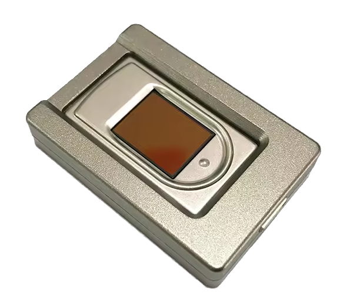

# Open LRU Fingerprint Library



A lightweight, dependency-free C library for **LRU series USB fingerprint sensors** on Linux. It replaces the vendor's SDK for the two jobs most applications need:

* **Probe** – list the sensors that are plugged in.
* **Read** – detect a finger, download the raw 256×288 image, and read the feature template the sensor extracts.

Made by *Shenzhen Lirox Information Technology Co., Ltd.*, the LRU series consists of compact USB fingerprint modules for embedded security and access-control devices. With an on-board processor handling image capture and template extraction, the modules communicate directly with the host via USB.

To implement and test this library, I use the popular, noticeably thin [LRU1011](https://s.click.aliexpress.com/e/_c4ljoMUd) USB fingerprint reader.

> There is no fingerprint matching, searching or verification in this library, by design. Images and templates are only read from the sensor.

## Quick start

```sh
sudo apt install build-essential pkg-config libgtk-3-dev      # GTK only for examples
make                                                          # library + examples
sudo cp udev/99-openlru.rules /etc/udev/rules.d/              # non-root access
sudo udevadm control --reload-rules && sudo udevadm trigger   # then re-plug
./build/gtk_capture                                           # sample capture program.
```

## Documentation

Full documentation for the Open LRU Fingerprint Library is available in the [wiki section](wiki) of this repository. The documentation covers installation, the API, architecture, the USB protocol, supported devices, and common troubleshooting steps.

## Limitations

* Support models: `2109:7638`, `0453:9005`, `0618:9018` and `2009:7638`.
* Only **256 × 288** images are supported.
* `2009:7638` / `2109:7638` are also used by some ordinary USB storage products; set `OLRU_DENY_MSC=1` to hide them from `olru_probe`.
* The kernel driver detached on open is not re-attached on close; re-plug the sensor to restore it.
* A handle must not be shared between threads.

## Legal

This is an independent implementation; the protocol was derived by analyzing the vendor's Linux SDK libraries and sniffing the USB communication link.

This project is not affiliated with or endorsed by the vendor.

This project is distributed under the terms of the [BSD-3-Clause license](LICENSE).